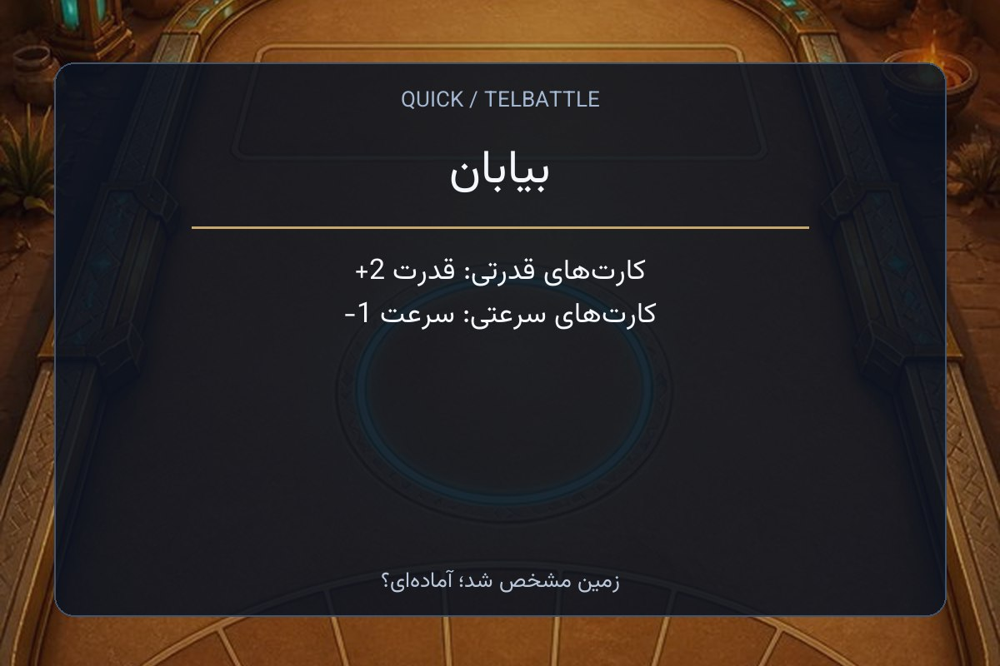
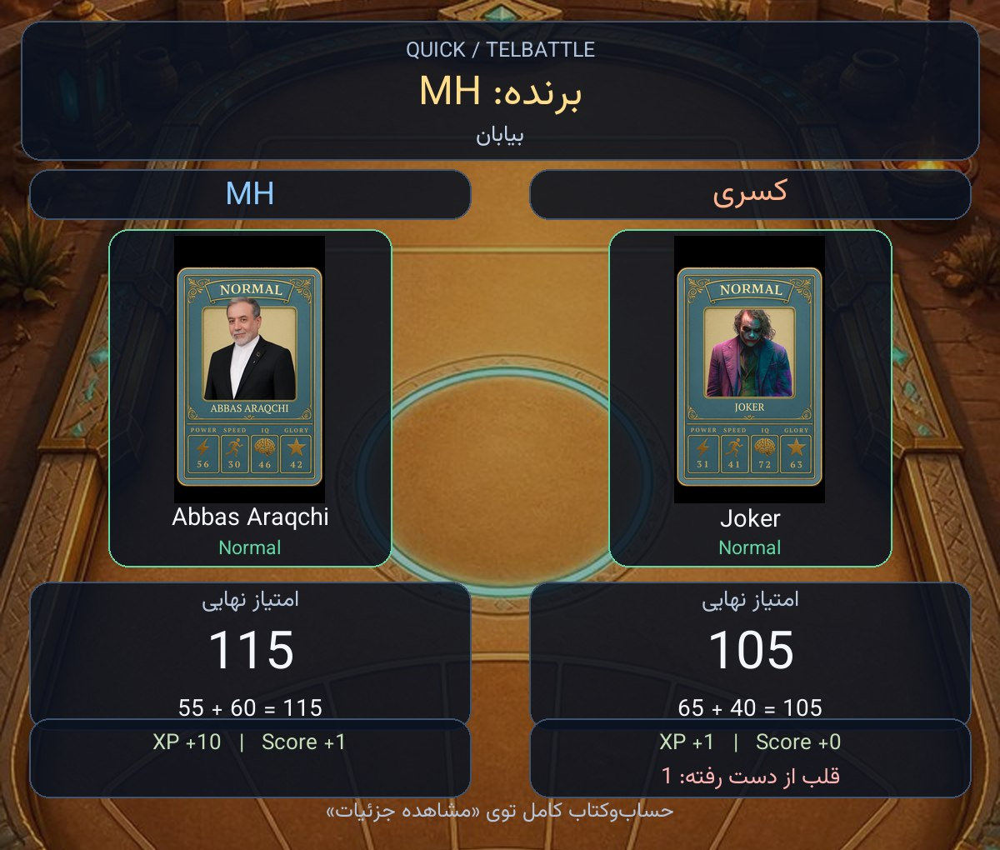

# تصویر زمین و نتیجهٔ نبرد در ربات

قاب سه‌کارتهٔ ساخت/مشاهدهٔ دک و شعار روی تصویر برد: [راهنمای عکس دک](DECK_VISUALS_FA.md).

## چه چیزی نمایش داده می‌شود؟

در **Quick و Deck تلگرامی**، پس از مشخص‌شدن زمین، تصویر همان زمین همراه نام و قوانین مسابقه در پیوی ربات برای هر دو بازیکن ارسال می‌شود. قوانین از snapshot مسابقه خوانده می‌شوند؛ تغییر تنظیمات ادمین حین مسابقه، قوانین تصویر را عوض نمی‌کند. در Quick با مصرف ابیلیتی تغییر زمین، تصویر زمین جدید هم ارسال می‌شود.

پایان بازی، هر دو بازیکن در پیوی ربات یک تصویر نتیجه می‌گیرند:

- پس‌زمینهٔ زمین نهایی همان مسابقه؛
- نام بازیکن‌ها، کارت‌ها و فرم واقعی آن‌ها؛
- Quick: دو کارت، امتیاز نهایی و جمع ویژگی‌های مؤثر؛
- Deck: کارت‌های بازی‌شدهٔ دو طرف، نتیجهٔ سه راوند و امتیاز نهایی با بونس ساخت دک؛
- XP و Score و قلبِ کم‌شده از نتیجهٔ ثبت‌شده، بدون پرداخت مجدد؛
- دکمهٔ «مشاهده جزئیات» برای گزارش خصوصی؛ دکمهٔ بازی دوبارهٔ Deck انتخاب گفت‌وگوی دوست را باز می‌کند.

کارت‌های Deck از snapshot هر راوند خوانده می‌شوند؛ تغییر فرم فعال پس از پایان مسابقه، کارتِ داخل نتیجه را عوض نمی‌کند. برای راوندهای قدیمی که شناسهٔ کارت ثبت نشده، نام و فرمِ ثبت‌شده حفظ و قاب جایگزین استفاده می‌شود. کارت بازی‌نشده در مسابقهٔ نیمه‌تمام حدس زده نمی‌شود. جزئیات بونس و پاداش‌های Deck نیز در گزارش پایدار قرار دارند و بعد از حذف رکورد fight قابل خواندن‌اند.

پیام و استیکر برد در گروه و منوی مشترک انتخاب Deck حفظ شده‌اند. این مرحله منوی اصلی، دعوت‌ها، Easy، Mini App و قوانین اقتصاد یا نبرد را تغییر نمی‌دهد.

## تصویرها از کجا می‌آیند؟

ده تصویر فعلی زمین‌ها در `frontend/game/public/arena-backgrounds/` از قبل در مخزن بودند و استفاده می‌شوند. برای زمین جدیدی که هنوز تصویر ندارد، `assets/battle_visuals/fallback-v1.png` طرح اولیهٔ عمومی است. نام و قانون زمین همیشه واقعی‌اند؛ استفاده از طرح عمومی، قانون زمین دیگری را وارد بازی نمی‌کند.

تصویر جدید با ابزار داخلی **imagegen** ساخته شد، بدون تصویر ورودی و بدون دانلود تصویر از وب. مسیر اصل تولیدشده در workspace: `assets/battle_visuals/fallback-v1.png`. پرامپت: پس‌زمینهٔ افقی یک آرنای تیرهٔ کارت‌بازی، نور نارنجی و آبی در دو طرف، فضای خالی میانی برای ترکیب کارت‌ها و نوشته‌ها، بدون متن، لوگو، واترمارک یا شخصیت. این فایل فقط طرح اولیه است و قابل جایگزینی است؛ برای مسابقه‌های واقعی دوباره از مدل تصویرساز استفاده نمی‌شود.

[پرامپت کامل و روش تولید](../assets/battle_visuals/fallback-v1.prompt.txt). پیش‌نمایش‌های زیر نمونهٔ ساختگیِ قالب‌اند و نتیجهٔ واقعی بازیکنان نیستند:





## چطور خودمان تصویر را عوض کنیم؟

نیازی به SSH، تغییر اطلاعات محرمانه یا نصب دستی فایل روی VPS نیست:

1. تصویر دلخواه PNG/JPEG/WebP را در `assets/battle_visuals/` بگذارید؛ مثلاً `desert-v2.png`.
2. در `assets/battle_visuals/sources.json` مسیر `arena/desert` را به `assets/battle_visuals/desert-v2.png` تغییر دهید. نام کلید همان ID زمین است. برای طرح عمومی کلید `arena/default` را عوض کنید.
3. در ریشهٔ مخزن اجرا کنید:

   ```powershell
   .\.venv\Scripts\python.exe scripts/build_battle_visual_assets.py
   .\.venv\Scripts\python.exe scripts/build_battle_visual_assets.py --check
   ```

4. تصویر، manifest و فایل تولیدشدهٔ `bot/battle_visual_assets.py` را همراه هم commit کنید؛ سپس همان مسیر عادی PR، CI، ادغام و Deploy را انجام دهید.

برای عوض‌کردن فقط ظاهر تلگرام، از مسیر مستقل `assets/battle_visuals/` استفاده کنید. عوض‌کردن فایل مشترک موجود در `frontend/game/public/arena-backgrounds/` روی Mini App هم اثر می‌گذارد.

تولیدکننده، تصویرها و فونت Vazirmatn با مجوز OFL را در یک منبع Python بسته‌بندی می‌کند. بنابراین بستهٔ محدود انتشار، بدون تغییر allowlist یا bootstrap، همهٔ رسانه‌های لازم را دارد. تصاویر، تنظیمات و symlinkهای مشترک سرور بازنویسی نمی‌شوند؛ schema و requirements تغییر نکرده‌اند و نصب کتابخانه روی VPS لازم نیست.

برای نصب‌های مدیریتی، override محلی اختیاری است: متغیر `TELBATTLE_BATTLE_MEDIA_DIR` به پوشه‌ای با فایل‌هایی مثل `desert.webp` اشاره می‌کند. تصویر نسخه‌دار snapshot با مسیر `/miniapp-assets/arena-backgrounds/<filename>` نیز از پوشهٔ محلی `MINIAPP_ARENA_MEDIA_DIR` خوانده می‌شود. URL خارجی دانلود نمی‌شود و مسیر بیرون از این پوشه پذیرفته نمی‌شود. اولویت: override محلی، فایل نسخه‌دار snapshot، تصویر بسته‌بندی‌شده، طرح عمومی. پس‌زمینهٔ انتخاب‌شده برای مسابقه در cache محدود نگه داشته می‌شود تا معرفی و نتیجه همان تصویر را استفاده کنند.

## خوانایی و خطاها

فونت فارسی همراه بسته است و شکل‌دهی حروف/ترتیب دوجهته با کتابخانه‌های Python همراه پروژه انجام می‌شود؛ به فونت Windows یا libraqm نصب‌شده روی سرور وابسته نیست. علامت عددها و نام‌های لاتین حفظ می‌شوند. اعلان‌های این قابلیت به قلم و تنظیمات تلگرام وابسته نیستند؛ متن داخل عکس است.

اگر تصویر کارت موجود نباشد، قاب با نام و فرم آن نمایش داده می‌شود؛ عکس Normal به جای Epic یا Legend استفاده نمی‌شود. رسانهٔ همان فرم از فایل محلی یا cache تلگرام قابل استفاده است. اگر ساخت/ارسال تصویر شکست بخورد، پیام متنی و دکمهٔ جزئیات باقی می‌مانند؛ موجودی و پاداش دوباره مصرف یا پرداخت نمی‌شود.

تصویرهای قدیمی که فقط با نام کارت و تنظیمات مسیر عکس پیدا می‌شوند، فقط برای خودِ فرم پایه استفاده می‌شوند؛ فرم دیگر باید رسانهٔ مخصوص خودش را داشته باشد.

رندر روی یک worker جدا از event loop، با حداکثر یک رندر هم‌زمان و مهلت انتظار دوثانیه‌ای انجام می‌شود. فونت، پس‌زمینه و تصاویر کوچک کارت cache دارند. فایل‌های بیش از ۸ مگابایت یا تصویرهای بیش از ۱۶ میلیون پیکسل پذیرفته نمی‌شوند. زمان و ظرفیت سرور واقعی با تست زنده اندازه‌گیری نشده؛ تست‌ها آفلاین‌اند.

## آزمون و بازبینی

`tests/test_battle_visuals.py` و تست‌های جریان Quick/Deck، قوانین snapshot، تغییر زمین، دو پیوی مستقل، فرم واقعی کارت، کنترل علامت عدد، رسانهٔ خراب/ناموجود، fallback متن، cache، محدودیت worker و حفظ پاداش را بررسی می‌کنند. جزئیات قدیمی و حالت بدون تصویر نیز تست می‌شوند. نتیجهٔ CI هر دو Python و بررسی artifact در PR ثبت می‌شود. این تغییر به‌تنهایی انتشار production نیست.

وابستگی‌های متن و مجوزهایشان: [THIRD_PARTY.md](../bot/_vendor/THIRD_PARTY.md).
