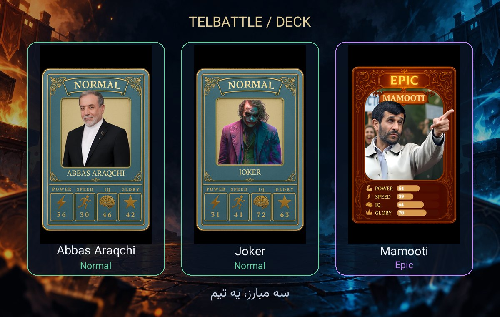
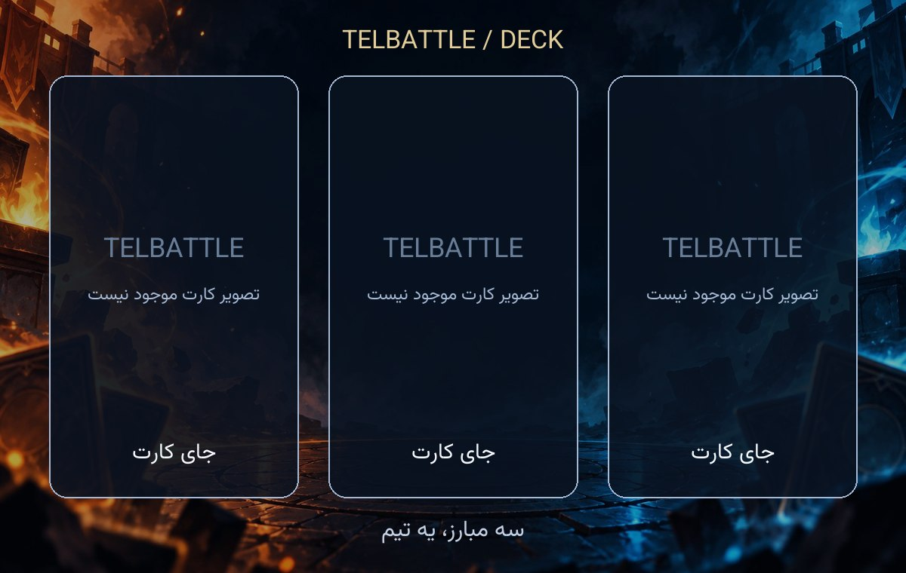

# عکس دک و شعار برد

بعد از انتخاب سه کارت و اسم دک، ربات می‌پرسد: «وقتی دکت می‌بره چی بگه؟». شعار بین ۱ تا ۱۲۰ کاراکتر است؛ دکمهٔ شعار پیش‌فرض هم داریم. تا تکمیل این مرحله، دک جدید ذخیره نمی‌شود. لغو، دک نیمه‌کاره ایجاد نمی‌کند.

بعد از ذخیره، یک عکس با سه کارت و فرم واقعی آن‌ها در پیوی ربات ارسال می‌شود. **اسم دک، مجموع بونس، علت هر بونس و شعار، زیر عکس در کپشن می‌آیند.** بونس از همان تابع محاسبهٔ بازی خوانده می‌شود؛ قانون یا مقدار جدیدی اضافه نشده است.

از زیر عکس می‌توان کارت‌ها، اسم یا شعار را تغییر داد. هر ویرایش موفق همان دک را ذخیره می‌کند و عکس تازه می‌فرستد. در «دک‌های من» با زدن مشاهدهٔ هر دک نیز عکس تازه ارسال می‌شود؛ تصویر قدیمیِ cacheشدهٔ دک استفاده نمی‌شود. تغییر کارت‌ها از دسته‌بندی و انتخاب سه کارت می‌گذرد؛ تا ذخیره، دک قبلی حفظ می‌شود. هنگام مسابقهٔ فعال، ویرایش از این مسیر متوقف می‌شود و پس از پایان مسابقه دوباره ممکن است.

در **پروفایل ← 🃏 شعار برد دک مود** می‌توان یک شعار شخصی بین ۱ تا ۱۲۰ کاراکتر نوشت، ویرایش یا پاک کرد. این بخش انتخاب شخصیت، استیکر یا ویس ندارد. شعار پروفایل برای همهٔ دک‌های همان بازیکن اولویت دارد؛ اگر پاک شود، شعار دستی قبلی هر دک استفاده می‌شود. اگر هیچ شعار دستی‌ای وجود نداشته باشد، فقط «🏆 برد مبارکت!» می‌آید؛ جملهٔ پیش‌فرض قدیمی به‌جای شعار کاربر ارسال نمی‌شود. در تساوی، شعار هیچ‌کدام به‌عنوان برنده نمایش داده نمی‌شود. شعارهای Easy مستقل‌اند.

## پایان Deck

تصویر نتیجهٔ فعلی با پس‌زمینهٔ زمین، سه کارت هر طرف و امتیازها برای هر دو بازیکن در پیوی ربات ارسال می‌شود؛ **شعار دک برنده کپشن همان عکس است**. تصویر تکراری دیگری فرستاده نمی‌شود. دکمه‌های مشاهدهٔ جزئیات و بازی دوباره باقی می‌مانند. شکست رسانه، متن و دکمه‌ها را نگه می‌دارد و باعث ذخیره یا پرداخت دوباره نمی‌شود.

اسم و شعار مؤثر (اول پروفایل، سپس شعار دستی دک) در زمان انتخاب آن برای مسابقه داخل گزارش ثبت می‌شوند؛ ویرایش پروفایل یا حذف بعدی دک، شعار نتیجهٔ همان بازی را تغییر نمی‌دهد. گزارش‌های قدیمی بدون شعار از پیام کوتاه برد استفاده می‌کنند. تنظیم پروفایل در `foundation_settings` با کلید `deck_victory:<user_id>` ذخیره می‌شود؛ migration لازم نیست.

## قاب و تعویض تصویر

این قاب با Pillow و سه جای کارت ساخته می‌شود؛ مدل تصویرساز برای هر بار استفاده اجرا نمی‌شود. طرح اولیهٔ زمینه همان تصویر عمومی ساخته‌شدهٔ مرحلهٔ قبل است و کلید مستقل `deck/template` دارد.





برای جایگزینی زمینه، یک PNG/JPEG/WebP دلخواه در `assets/battle_visuals/` بگذارید و فقط مسیر `deck/template` در `assets/battle_visuals/sources.json` را عوض کنید؛ سپس:

```powershell
.\.venv\Scripts\python.exe scripts/build_battle_visual_assets.py
.\.venv\Scripts\python.exe scripts/build_battle_visual_assets.py --check
```

تصویر، manifest و `bot/battle_visual_assets.py` را با هم commit کنید. جای سه کارت در `bot/battle_visuals.py`، تابع `render_deck` مشخص است. override محلی اختیاری برای مدیر سرور: `deck-template.png` یا jpg/webp/jpeg در `TELBATTLE_BATTLE_MEDIA_DIR`؛ تنظیم تازهٔ سرور برای مسیر عادی انتشار لازم نیست. قاب و فونت همراه بستهٔ انتشارند؛ تصاویر مشترک سرور بازنویسی نمی‌شوند.

تصاویر فرم دیگر قرض گرفته نمی‌شوند؛ عکس ناموجود با قابِ نام و فرم کارت جایگزین می‌شود. تصویرها روی worker محدود مرحلهٔ قبل ساخته می‌شوند. [جزئیات رسانه، خوانایی فارسی و مجوزها](BATTLE_VISUALS_FA.md).

## داده و انتشار

schema تغییر نکرده است: متادیتای نمایشی دک در جدول JSON موجود `foundation_settings` با کلید مستقل `deck_presentation:<deck_id>` ذخیره می‌شود. این کلیدها وارد feature flag یا اقتصاد نمی‌شوند. ساخت، ویرایش و حذف متادیتا در تراکنش همان دک انجام می‌شود و با حذف دک پاک می‌شود. خواندن/راه‌اندازی، رکورد جدید نمی‌سازد و دک‌های قبلی را بازنویسی نمی‌کند. snapshot مسابقه از جدول گزارش موجود استفاده می‌کند؛ migration یا bootstrap جدیدی لازم نیست.

API فعلی Mini App فیلد اختیاری `victory_slogan` را می‌پذیرد و در پاسخ برمی‌گرداند؛ ویرایش‌های قدیمی بدون این فیلد، شعار را حفظ می‌کنند. نمایش و مرحلهٔ جدید انتخاب شعار در **ربات تلگرام** است؛ رابط Mini App و منوی اصلی تغییر نکرده‌اند.

تست‌ها با SQLite موقت، ساخت کامل، شعار نامعتبر و لغو، دک قدیمی، ویرایش و بازنمایی، بونس واقعی، callbackهای عکس، کنترل مالکیت، خطای عکس، snapshot و برد پس از حذف دک، پایان مهلت قبل از اولین راوند و سازگاری API را بررسی می‌کنند. تعداد واقعی تست‌ها و artifact در PR ثبت می‌شود. فعال‌شدن در بازی نیازمند ادغام و انتشار نسخه است.
