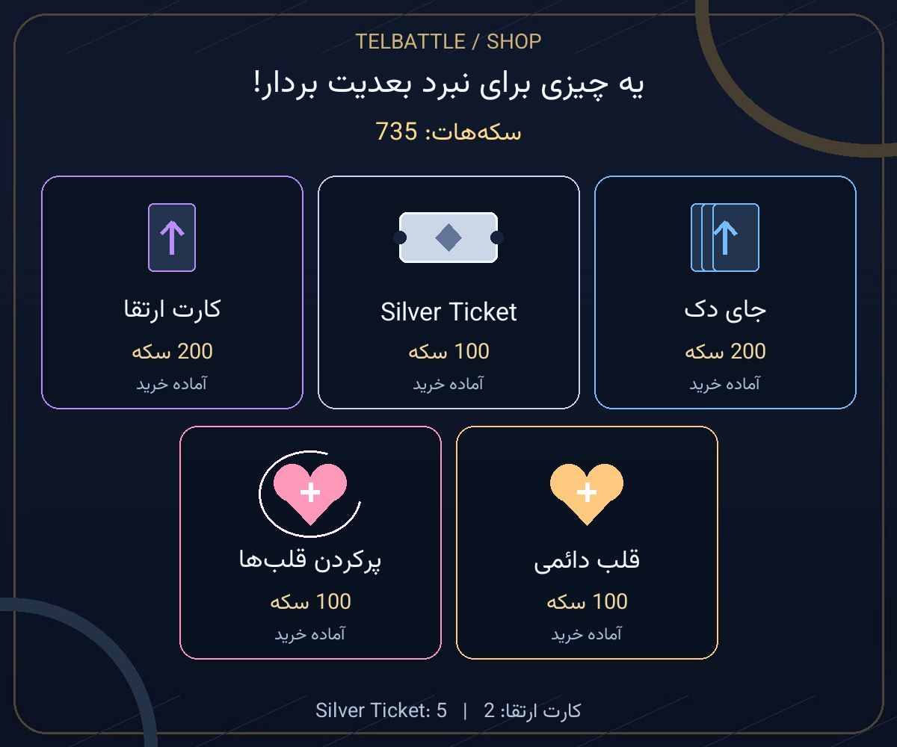
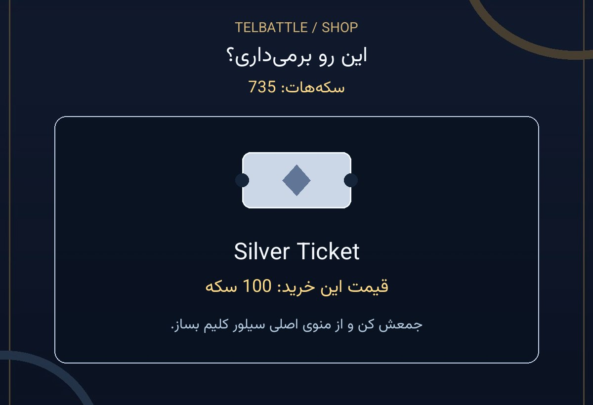
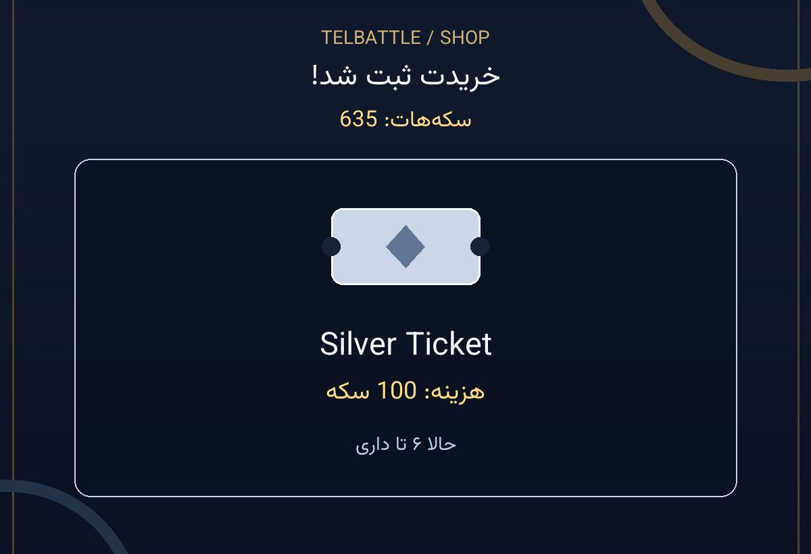

# فروشگاه تصویری ربات

فروشگاه اقتصاد فعلی، ویترین تصویری و متن کوتاه دارد. منوی اصلی و رابط Mini App تغییر نکرده‌اند؛ مسیرهای قدیمی اقتصاد دوباره فعال نمی‌شوند. Silver Claim همچنان در منوی اصلی است و داخل فروشگاه فقط **Silver Ticket** فروخته می‌شود.

## جریان خرید

1. ویترین، سکه‌های فعلی، پنج کالای موجود در تنظیمات، قیمت خرید بعدی و موجودی کارت ارتقا/تیکت را نشان می‌دهد. کالای غیرفعال حذف می‌شود؛ ناموجودبودن، پر بودن قلب‌ها و سقف ظرفیت مشخص‌اند.
2. بعد از انتخاب کالا، نام، توضیح یک‌خطی، هزینه و سکه‌های فعلی همراه دکمهٔ «آره، می‌خرم» و «نه، برگردیم» می‌آیند. اگر سکه کم باشد، کسری نمایش داده می‌شود و دکمهٔ پرداخت نداریم. قیمت تا پنج دقیقه معتبر است؛ اعتبار واقعی در سرور بررسی می‌شود.
3. خرید موفق، تصویر همان کالا، هزینهٔ ثبت‌شده، موجودی سکه و تعداد/ظرفیت تازه را نشان می‌دهد: «مبارکه، مال تو شد!». خرید تکراری صریحاً اعلام می‌کند قبلاً ثبت شده و دوباره سکه کم نشده است.
4. تغییر قیمت، اتمام موجودی، انقضا و کمبود سکه پیام کوتاه و مسیر بازگشت دارند. خرید اسکین از بخش کارت نیز نام همان اسکین را در تأیید نشان می‌دهد و دکمهٔ انصراف به اسکین‌های همان کارت برمی‌گردد.







عددهای این سه نمونه ساختگی‌اند؛ تصویر واقعی از اطلاعات حساب و تنظیمات همان لحظه ساخته می‌شود.

## تصویر و دکمه‌ها

یک تصویر بالای پیام کوتاه دکمه‌ها قرار دارد. انتخاب کالا، رسید و بازگشت به ویترین، تصویر همان پنل را ویرایش می‌کنند؛ برای هر کلیک عکس تازه‌ای به تاریخچه اضافه نمی‌شود. دکمه‌ها روی پیام متنی هستند، بنابراین callbackهای کارت‌ها، مأموریت‌ها، اسکین‌ها و بازگشت به منوی اصلی همان نوع پیام قبلی را می‌گیرند. کنترل‌های پنل قبلی هنگام ساخت پنل تازه کنار گذاشته می‌شوند.

شناسهٔ تصویر و کنترل‌ها در cache محدود به ۱۲۸ پنل، با کلید گفت‌وگو/پیام/کاربر نگهداری می‌شود. بعد از راه‌اندازی مجدد یا حذف تصویر، پنل قابل بازسازی است. شکست تصویر، دکمه‌ها و متن را حفظ می‌کند؛ خرید دوباره اجرا نمی‌شود. متن‌ها و دکمه‌ها هم قیمت و موجودی سکه را دارند و فقط به خواندن عکس وابسته نیستند.

پس‌زمینه و آیکن‌های کالا با Pillow و شکل‌های ساده ساخته شده‌اند؛ مدل تصویرساز برای هر خرید اجرا نمی‌شود. فونت فارسی همراه بسته است و متن فارسی/لاتین با renderer فعلی ربات نوشته می‌شود. پردازش تصویر همان worker محدود و خارج از event loop را استفاده می‌کند.

## قیمت و امنیت عملیات

`ProgressionEconomy.shop_catalog` از **همان `price_in` و `shop_eligible`** استفاده می‌کند. بنابراین قیمت افزایشی، پنجرهٔ روزانه/هفتگی، موجودی عمومی و رزرو جایزهٔ قلب آینده تابع اقتصاد موجودند. دیدن ویترین quote یا خرید ثبت نمی‌کند، سکه کم نمی‌کند و قلب‌ها را تازه نمی‌کند. ایجاد احتمالی رکورد ظرفیت حساب همان رفتار موجود `capacities_in` است.

quote و purchase قبلی، مرجع قطعی قیمت و پرداخت باقی می‌مانند؛ هر تغییر بین مشاهده و پرداخت دوباره اعتبارسنجی می‌شود. مالکیت quote، ledger، replay، تعداد نسخه‌ها، XP، Claim، قیمت‌ها و تنظیمات اقتصاد تغییر نکرده‌اند. این تغییر schema یا bootstrap تازه ندارد.

## تعویض ظاهر

- پس‌زمینهٔ اولیه: `assets/battle_visuals/shop-template-v1.png`.
- نگاشت مستقل: `shop/template` در `assets/battle_visuals/sources.json`.
- آیکن‌ها، قاب و جای نوشته‌ها: `bot/shop_visuals.py`.
- متن‌ها و دکمه‌های خرید: `bot/shop_presentation.py`.

برای جایگزینی زمینه، PNG/JPEG/WebP دلخواه را در `assets/battle_visuals/` بگذارید، مسیر `shop/template` را عوض کنید و اجرا کنید:

```powershell
.\.venv\Scripts\python.exe scripts/build_battle_visual_assets.py
.\.venv\Scripts\python.exe scripts/build_battle_visual_assets.py --check
```

تصویر، manifest و `bot/battle_visual_assets.py` را با هم commit کنید. برای بازسازی طرح اولیهٔ کدنویسی‌شده، `scripts/build_shop_template.py` را قبل از بسته‌بندی اجرا کنید. override مدیریتی اختیاری: `shop-template.png` یا webp/jpg/jpeg در `TELBATTLE_BATTLE_MEDIA_DIR`. نصب عادی از منابع همراه release استفاده می‌کند؛ فایل مشترک سرور بازنویسی نمی‌شود.

## آزمون و انتشار

`tests/test_shop_presentation.py` جریان واقعی quote/purchase، استفادهٔ دوباره از تصویر، callback متنی، قیمت افزایشی/سفارشی، مشاهده بدون خرید، ناموجود/غیرفعال، پر بودن قلب/سقف ظرفیت، quote منقضی/متعلق به دیگری، کسری سکه، replay، شکست تصویر، نام اسکین و برگشت به بخش‌های قبلی را با SQLite موقت بررسی می‌کند. تست‌های موجود اقتصاد، کلیم و کارت‌ها هم اجرا می‌شوند. نتیجهٔ CI هر دو Python و بررسی artifact در PR ثبت می‌شود؛ این تغییر به‌خودی‌خود انتشار production نیست.
